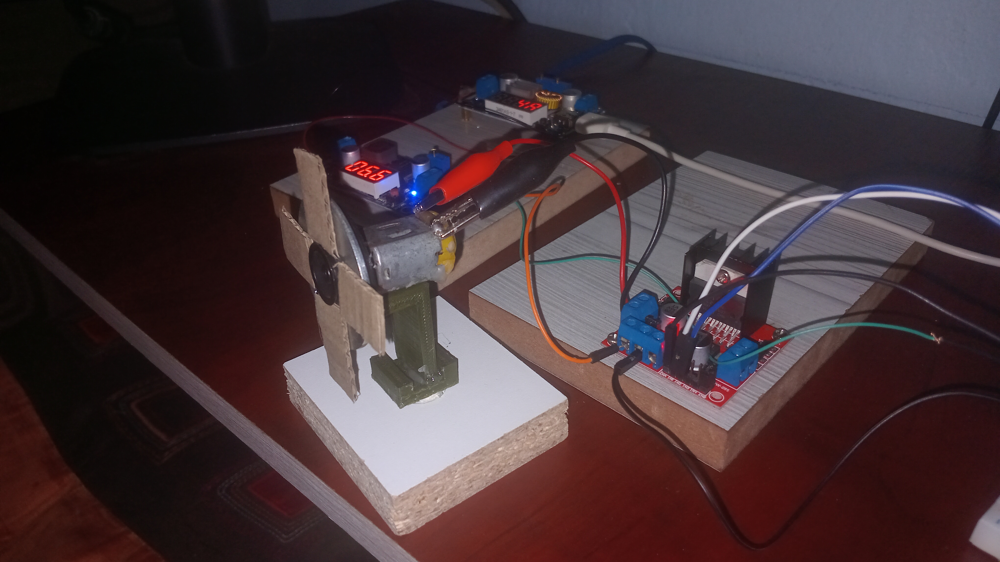
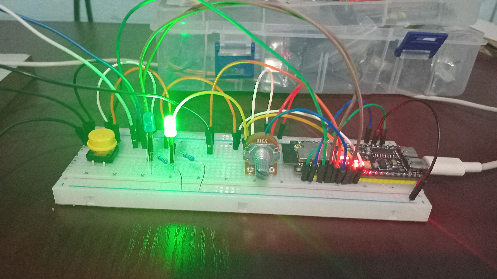
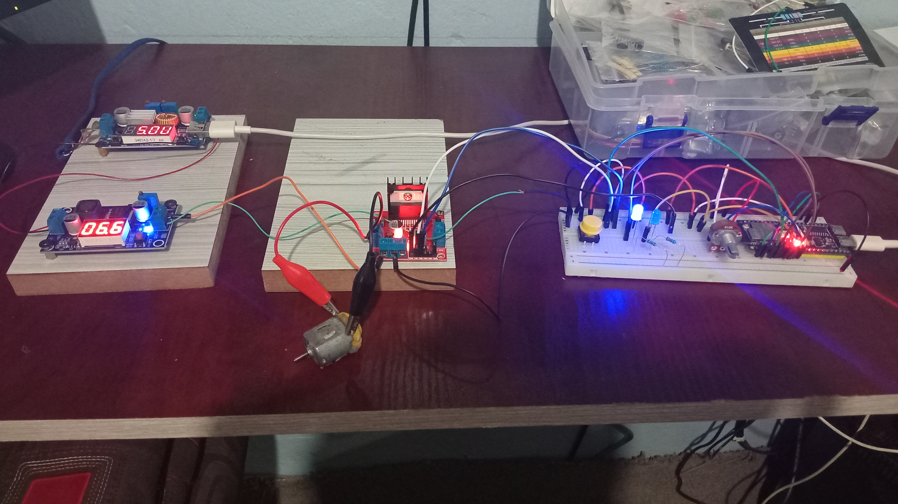
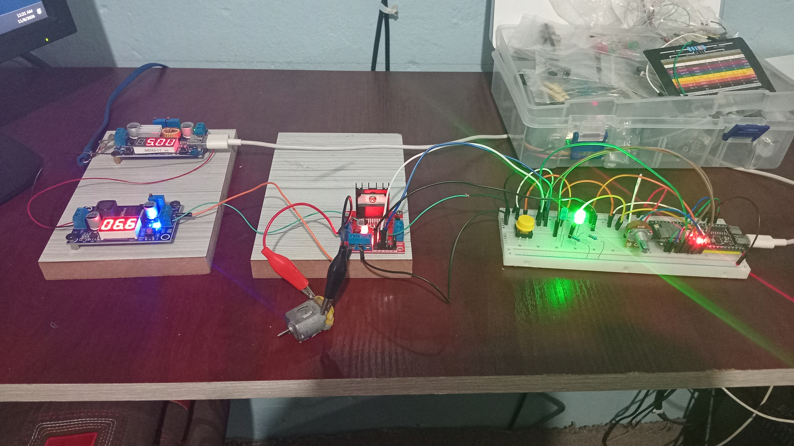
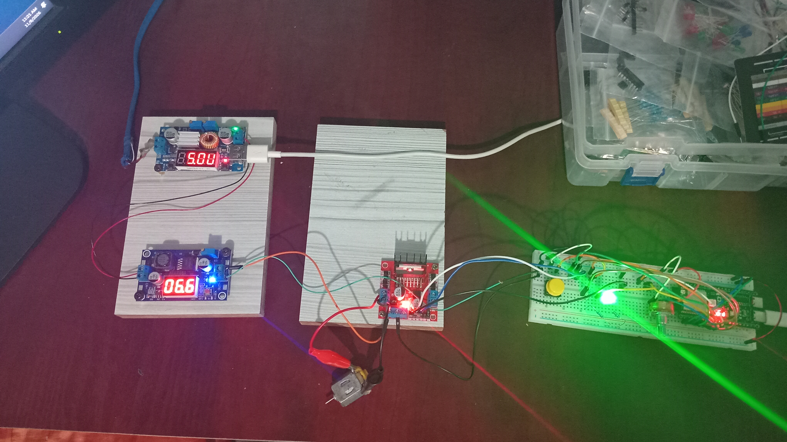

# ESP32-S3 L298N Motor Control

An ESP32-S3 N16R8 project that controls a DC motor through an L298N driver. A potentiometer sets motor speed, a push button switches direction, and two LEDs indicate the selected direction.

## Folder structure

```text
esp32-l298n-motor-control/
├── README.md
├── images/
│   ├── esp32-l298n-wiring.jpg
│   └── project-setup.jpg
└── src/
    └── esp32_l298n_motor_control/
        └── esp32_l298n_motor_control.ino
```

## Components

- ESP32-S3 N16R8 development board
- L298N motor driver
- DC motor and suitable external motor power supply
- Potentiometer
- Push button
- Two LEDs with current-limiting resistors

## Pin connections

| ESP32-S3 | L298N / component | Purpose |
| --- | --- | --- |
| GPIO 6 | ENA | PWM motor speed |
| GPIO 4 | IN1 | Direction control |
| GPIO 5 | IN2 | Direction control |
| GPIO 7 | Potentiometer wiper | Speed input |
| GPIO 17 | Button output | Direction toggle |
| GPIO 15 | LED 1 anode through resistor | Left direction indicator |
| GPIO 16 | LED 2 anode through resistor | Right direction indicator |
| GND | L298N GND and component grounds | Shared ground |

Connect the motor to L298N **OUT1** and **OUT2**, and connect the motor supply to the L298N motor power input. Remove the **ENA jumper** to use GPIO 6 for PWM speed control. Power the ESP32 and motor appropriately; do not power the motor from an ESP32 GPIO. With `INPUT_PULLDOWN`, wire the button between GPIO 17 and 3.3 V.

Wire the potentiometer's two outer terminals to 3.3 V and GND, and its wiper to GPIO 7. Confirm the board pinout and motor driver's supply requirements for your hardware.

## Photos

Add your photos using these filenames, or update the image paths below:

### Wiring





### Completed project





## Upload and use

1. Open `src/esp32_l298n_motor_control/esp32_l298n_motor_control.ino` in the Arduino IDE.
2. Select your ESP32-S3 board and serial port, then upload.
3. Open Serial Monitor at **115200 baud**.
4. Turn the potentiometer to adjust speed. Press the button to switch direction.

The Serial Monitor reports the selected direction when it changes and reports sensor/PWM values every 200 ms. The potentiometer reading is mapped to PWM values from 0 to 255.

## GitHub repository name

`ESP32-l298n-motor-control`
